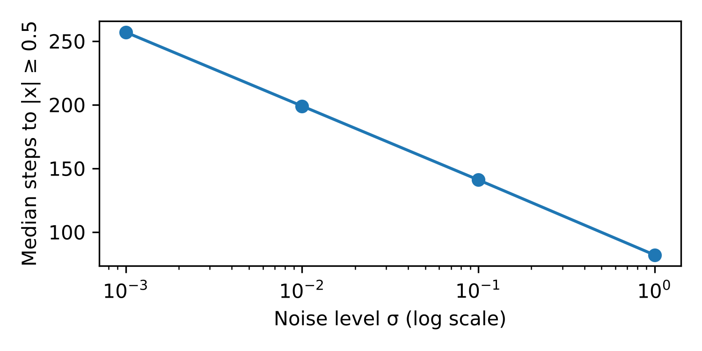
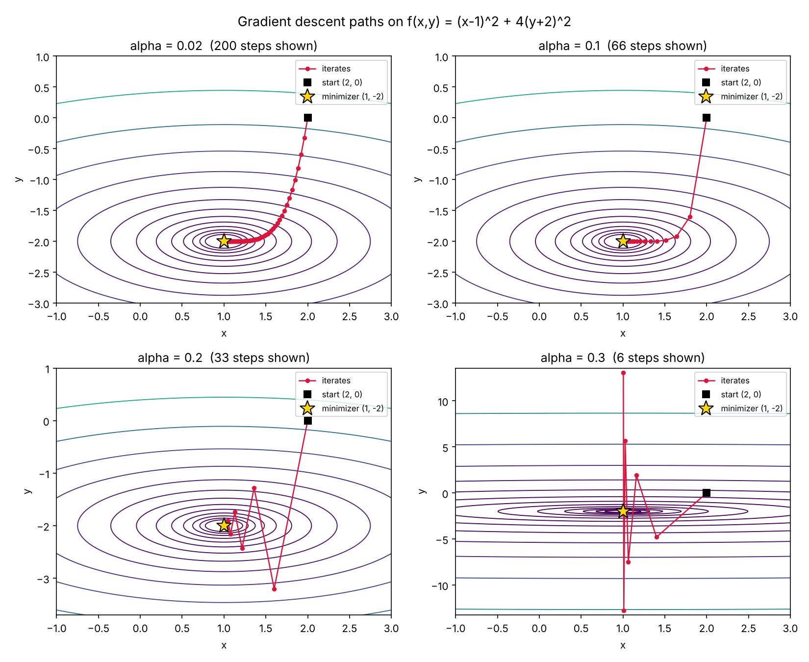

# Noisy gradient descent: escaping a hilltop

A pilot experiment from my Fall 2026 Directed Reading Program in mathematics at Kansas State University, studying gradient descent under noisy gradients.

## Question

Gradient descent moves by subtracting a step size times the gradient. At any point where the gradient is zero, it does not move at all, so a hilltop looks the same as a valley floor. In machine learning, gradients are usually estimated from small random samples of data, so they carry noise. This pilot asks: **if gradient descent starts on a hilltop, how long does noise take to push it off, and how much does the noise level matter?**

## Setup

- Function: f(x) = (x² − 1)², a double well with a local maximum at x = 0 and minima at x = ±1
- Start: x = 0, where the true gradient is zero
- Update: x ← x − α (f′(x) + σ·ξ), with ξ drawn from a standard normal distribution
- Step size: α = 0.01
- Noise levels: σ ∈ {0.001, 0.01, 0.1, 1}
- 1,000 independent runs per noise level; a run has escaped once |x| ≥ 0.5
- Random seed fixed at 1 for reproducibility

## Results

| Noise level σ | Median steps to escape |
|---|---|
| 0.001 | 257 |
| 0.01 | 199 |
| 0.1 | 141 |
| 1 | 82 |



Without noise (σ = 0), the iterate never leaves x = 0. With noise, each tenfold increase in σ saves only about 60 steps. Once noise nudges x away from 0, the true gradient takes over and pushes it away quickly, so the size of the first nudge matters relatively little.

## Related: step size on a 2D quadratic (no noise)

`step-size-2d/pilot.py` runs plain gradient descent on f(x, y) = (x − 1)² + 4(y + 2)², starting at (2, 0), to see how step size interacts with curvature that differs by direction. Each step multiplies the distance to the minimum (1, −2) by 1 − 2α in x and 1 − 8α in y, so the steep y direction is stable only when α < 0.25.

| Step size α | x factor | y factor | Steps until gradient < 10⁻⁶ (cap 200) |
|---|---|---|---|
| 0.02 | 0.96 | 0.84 | not reached in 200 steps |
| 0.1 | 0.80 | 0.20 | 66 |
| 0.2 | 0.60 | −0.60 | 33 (y overshoots back and forth) |
| 0.3 | 0.40 | −1.40 | diverges in y |



This noise-free run is the baseline for the planned noisy version of the same function.

## Run it

```
pip install -r requirements.txt
python research.py
```

Prints the four medians and saves `my_pilot_figure.png`. For the 2D step-size run: `cd step-size-2d && python pilot.py` (prints the table above and saves `gd_paths.png`).

## Next steps

Planned experiments, not yet run: how noise spreads the iterates around a minimum on a two-dimensional quadratic, and how escape time from a true saddle point changes with dimension (up to 1,000 dimensions).
